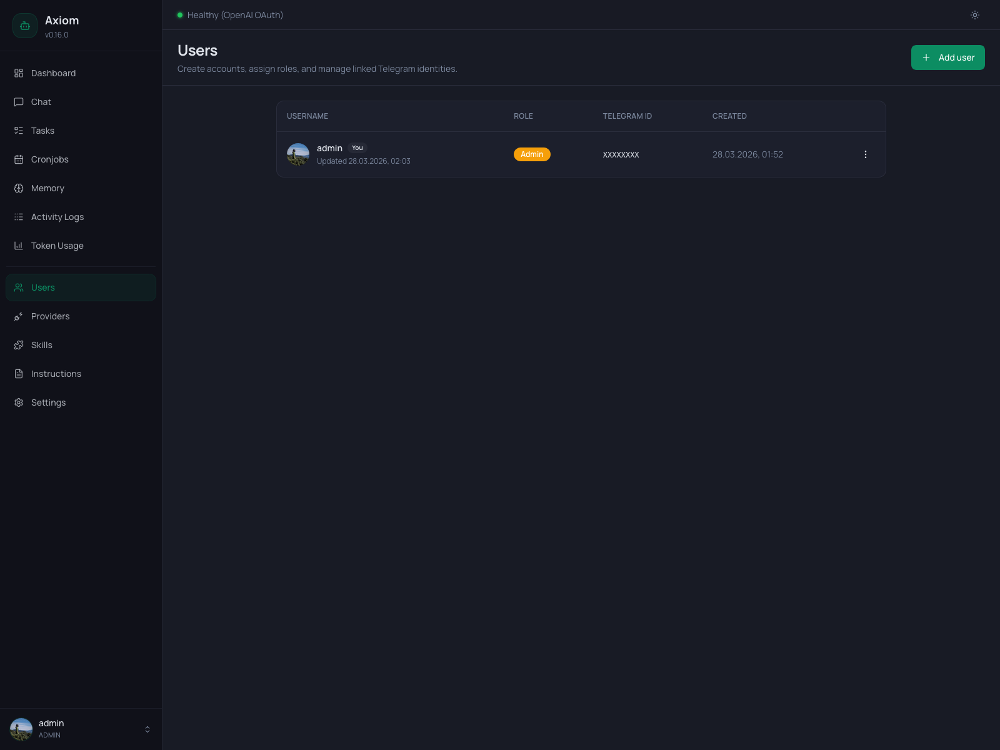

# Users

The Users page is where you add, remove, and manage local accounts for the Axiom web UI. Each row is one entry in the local `users` table — username, role, optional Telegram link, and timestamps. The actual linking of Telegram identities to accounts happens elsewhere (see [Telegram linking](#telegram-linking) below).

> **Admins manage all accounts.** Regular users see the page too, but only their own row, where they can change their own password (see [Your own account](#your-own-account)).

> **Multi-user.** Every account gets its own agent runtime, conversation, memory, tasks, cronjobs, email and settings. The wiki and global configuration are shared. Isolation is cooperative, not hard — see [Multi-User](../concepts/multi-user).

## Header

A single primary button on the right:

- **Add user** — opens the create dialog (see [Add user dialog](#add-user-dialog) below).

There is no Refresh button — the list is loaded on mount and re-fetched after any successful create / edit / delete.

## Users table

### Columns

| Column         | Notes                                                                                              |
|----------------|----------------------------------------------------------------------------------------------------|
| **Username**   | Avatar + username + a `You` badge for the currently signed-in account. Below the username, a small `Updated <date>` line shows when the row was last modified. |
| **Role**       | `Admin` (amber badge) or `User` (green badge). See [Roles](#roles).                                |
| **Telegram ID**| The numeric Telegram user ID if the account is linked, monospace. `Not linked` otherwise.          |
| **Created**    | Local timestamp (medium date + short time).                                                        |
| **⋮**          | Per-row menu — Edit, Delete.                                                                       |

Clicking anywhere on a row opens the edit dialog.

### Avatars

The avatar logic is simple:

- **Linked to Telegram** → the user's Telegram profile photo is fetched from `/api/telegram-users/avatar-by-telegram-id/<id>` and rendered as a 36 px round image. If the photo can't be loaded (no avatar set, network error), the cell falls back to the initial.
- **Not linked** → a round badge with the user's first initial on a tinted background.

Avatars are purely cosmetic — they have no bearing on auth or routing.

### Empty state

When the table is empty (nothing has been created yet, *or* the only admin was somehow removed), you see a centered users icon and the message *"No users found."*. Create a fresh account via **Add user**.

## Roles

Two roles, hard-coded:

| Role        | What they can access                                                                                              |
|-------------|-------------------------------------------------------------------------------------------------------------------|
| **`admin`** | Everything — every sidebar entry, every Settings panel, all of Users. The first admin is bootstrapped via environment variables on the very first run; see [Configuration](../guide/configuration). |
| **`user`**  | [Chat](./chat), own tasks and cronjobs, email, [Memory](./memory), the personal Settings tabs and their own account on this page. Admin-only pages show a locked screen. |

There is no per-feature permission system. *Admin* means "operator of this Axiom deployment"; *user* means "someone with their own private agent context". See [Multi-User](../concepts/multi-user) for what is private and what is shared. For hard isolation, run a separate Axiom instance per audience.

## Add user dialog

Opened by the **Add user** button. Fields:

| Field      | Notes                                                                                              |
|------------|----------------------------------------------------------------------------------------------------|
| **Username** | Required. Letters and digits only. Used for login and for the personal folder `/data/users/<username>/` and workspace `/workspace/<username>/`, which are created automatically. Rejected if a matching folder already exists. |
| **Role**     | `User` (default) or `Admin`. See [Roles](#roles).                                                |
| **Language / Timezone** | Optional starting values for the user's personal settings. |
| **Password** | Required, **minimum 4 characters**. Plaintext only at submission — stored hashed in the database. |

Hit **Save** to create. On success the dialog closes, a green banner appears at the top of the page, and the new row is in the table.

## Edit dialog

Opened by clicking a row or selecting *Edit* from the row menu. Same dialog as Add, with two differences:

- **Username is hidden.** Once an account is created, you can't rename it — username doubles as a memory-file identifier and a session foreign key, so changing it would orphan history. To "rename" a user, create a new account and delete the old one.
- **Password becomes optional**, relabeled **Reset password**. Leave blank to keep the current password unchanged; type a new value to replace it.

Resetting a password or changing a role **signs the user out everywhere immediately**: every issued access and refresh token is rejected (HTTP and WebSocket) and the user's open chat/task/log sockets are closed. A role change therefore takes effect right away — the user logs in again and gets the new role. Roles are always read from the database, never trusted from the token.

The bootstrap admin (the oldest admin account, normally the first account) cannot be demoted or deleted. An account older than it cannot be promoted to admin either, because it would take over the bootstrap admin's legacy data.

## Your own account

Regular users see only their own row. Click it (or **Change password**) to open the password dialog:

- **Current password** is required and must be correct.
- **New password** must be at least 4 characters.

On success all your *other* logins (other browsers, devices) are signed out; the current session stays signed in. Regular users cannot change their role or username, and cannot see or manage other accounts.

## Delete

Selecting *Delete* from the row menu opens a `ConfirmDialog`:

> **Delete `<username>`?** This action cannot be undone.

The dialog has a **Also delete the personal folder and workspace** checkbox, on by default. Deleting is a *soft delete*:

- **Removed:** running tasks are stopped; cronjobs and reminders are deleted and unregistered; email accounts (including credentials) and the user's sent-log entries are deleted; chat messages, tool calls, facts, task rows and task journals are deleted, as are uploads referenced in their chats. The Telegram link is dropped, and the user's runtime and session end without a summary or fact extraction.
- **Files:** with the checkbox on, `/data/users/<username>/` and `/workspace/<username>/` are deleted too. With it off they stay on disk. The workspace is only deleted if Axiom created it when the account was added: for accounts from before multi-user support, `/workspace/<username>/` may be an unrelated folder, so it is kept and the success message lists it.
- **Kept:** sessions and token usage stay, so the [Usage](./token-usage) page lists the user as `<name> (deleted)`. The user row stays too, so the **username stays reserved** and cannot be used for a new account.
- **Signed out immediately:** all tokens and open sockets of the deleted user are rejected.
- **Protected accounts:** you can't delete yourself, and the bootstrap admin can't be deleted by anyone.

## Telegram linking

The **Telegram ID** column is read-only here — it just *displays* whether an account is linked. The actual linking happens in **[Settings → Telegram](../settings/telegram#telegram-users)**:

1. A new Telegram user messages the bot.
2. They appear in the Telegram-users panel as *unassigned*.
3. You approve them and pick which Axiom user account to assign their identity to.
4. The Telegram ID then shows up here.

This split exists because Telegram users have their own metadata (display name, username, language code, photo) that doesn't map cleanly onto the local `users` table. The Telegram-users management is its own thing; this page just surfaces the result.

A single Axiom user can only be linked to one Telegram identity at a time.

## See also

- [Configuration](../guide/configuration) — how the first admin is bootstrapped via environment variables.
- [Settings → Telegram](../settings/telegram) — the actual Telegram user-approval and assignment flow.
- [Memory → User Profile](./memory#user-profile) — the private profile file each account gets (`/data/users/<username>/PROFILE.md`; the bootstrap admin keeps `/data/memory/users/<username>.md`).
- [Multi-User](../concepts/multi-user) — isolation level, private vs. shared data, recommended setup.
- [Chat](./chat) — the main page for every user.
